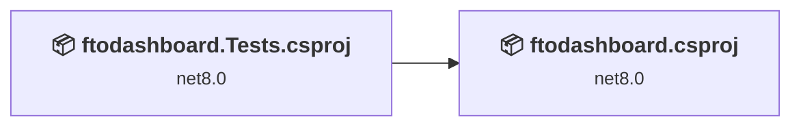
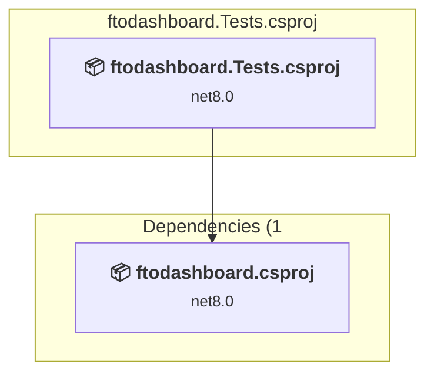
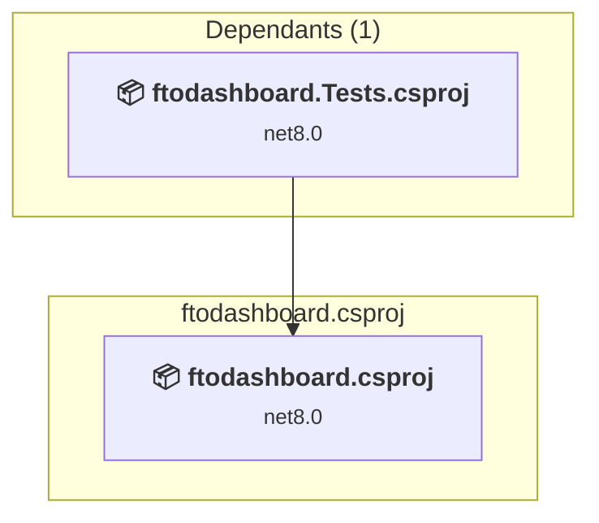

# Projects and dependencies analysis

This document provides a comprehensive overview of the projects and their dependencies in the context of upgrading to .NETCoreApp,Version=v10.0.

## Table of Contents

- [Executive Summary](#executive-Summary)
  - [Highlevel Metrics](#highlevel-metrics)
  - [Projects Compatibility](#projects-compatibility)
  - [Package Compatibility](#package-compatibility)
  - [API Compatibility](#api-compatibility)
- [Aggregate NuGet packages details](#aggregate-nuget-packages-details)
- [Top API Migration Challenges](#top-api-migration-challenges)
  - [Technologies and Features](#technologies-and-features)
  - [Most Frequent API Issues](#most-frequent-api-issues)
- [Projects Relationship Graph](#projects-relationship-graph)
- [Project Details](#project-details)

  - [ftodashboard.Tests\ftodashboard.Tests.csproj](#ftodashboardtestsftodashboardtestscsproj)
  - [ftodashboard\ftodashboard.csproj](#ftodashboardftodashboardcsproj)

## Executive Summary

### Highlevel Metrics

| Metric | Count | Status |
| :--- | :---: | :--- |
| Total Projects | 2 | All require upgrade |
| Total NuGet Packages | 22 | 7 need upgrade |
| Total Code Files | 68 |  |
| Total Code Files with Incidents | 5 |  |
| Total Lines of Code | 3936 |  |
| Total Number of Issues | 21 |  |
| Estimated LOC to modify | 9+ | at least 0.2% of codebase |

### Projects Compatibility

| Project | Target Framework | Difficulty | Package Issues | API Issues | Est. LOC Impact | Description |
| :--- | :---: | :---: | :---: | :---: | :---: | :--- |
| [ftodashboard.Tests\ftodashboard.Tests.csproj](#ftodashboardtestsftodashboardtestscsproj) | net8.0 | 🟢 Low | 3 | 0 |  | DotNetCoreApp, Sdk Style = True |
| [ftodashboard\ftodashboard.csproj](#ftodashboardftodashboardcsproj) | net8.0 | 🟢 Low | 7 | 9 | 9+ | AspNetCore, Sdk Style = True |

### Package Compatibility

| Status | Count | Percentage |
| :--- | :---: | :---: |
| ✅ Compatible | 15 | 68.2% |
| ⚠️ Incompatible | 1 | 4.5% |
| 🔄 Upgrade Recommended | 6 | 27.3% |
| ***Total NuGet Packages*** | ***22*** | ***100%*** |

### API Compatibility

| Category | Count | Impact |
| :--- | :---: | :--- |
| 🔴 Binary Incompatible | 2 | High - Require code changes |
| 🟡 Source Incompatible | 3 | Medium - Needs re-compilation and potential conflicting API error fixing |
| 🔵 Behavioral change | 4 | Low - Behavioral changes that may require testing at runtime |
| ✅ Compatible | 7495 |  |
| ***Total APIs Analyzed*** | ***7504*** |  |

## Aggregate NuGet packages details

| Package | Current Version | Suggested Version | Projects | Description |
| :--- | :---: | :---: | :--- | :--- |
| Azure.Extensions.AspNetCore.Configuration.Secrets | 1.4.0 |  | [ftodashboard.csproj](#ftodashboardftodashboardcsproj) | ✅Compatible |
| Azure.Identity | 1.14.1 |  | [ftodashboard.csproj](#ftodashboardftodashboardcsproj) | ⚠️NuGet package is deprecated |
| Azure.Security.KeyVault.Secrets | 4.8.0 |  | [ftodashboard.csproj](#ftodashboardftodashboardcsproj) | ✅Compatible |
| Azure.Storage.Blobs | 12.24.1 |  | [ftodashboard.csproj](#ftodashboardftodashboardcsproj) | ✅Compatible |
| Azure.Storage.Common | 12.23.0 |  | [ftodashboard.csproj](#ftodashboardftodashboardcsproj) | ✅Compatible |
| coverlet.collector | 6.0.4 |  | [ftodashboard.csproj](#ftodashboardftodashboardcsproj) | ✅Compatible |
| Microsoft.ApplicationInsights | 2.23.0 |  | [ftodashboard.csproj](#ftodashboardftodashboardcsproj) | ✅Compatible |
| Microsoft.ApplicationInsights.AspNetCore | 2.23.0 |  | [ftodashboard.csproj](#ftodashboardftodashboardcsproj) | ✅Compatible |
| Microsoft.AspNetCore.Authentication.OpenIdConnect | 8.0.18 | 10.0.1 | [ftodashboard.csproj](#ftodashboardftodashboardcsproj) | NuGet package upgrade is recommended |
| Microsoft.EntityFrameworkCore | 9.0.7 | 10.0.1 | [ftodashboard.csproj](#ftodashboardftodashboardcsproj) [ftodashboard.Tests.csproj](#ftodashboardtestsftodashboardtestscsproj) | NuGet package upgrade is recommended |
| Microsoft.EntityFrameworkCore.InMemory | 9.0.7 | 10.0.1 | [ftodashboard.Tests.csproj](#ftodashboardtestsftodashboardtestscsproj) | NuGet package upgrade is recommended |
| Microsoft.EntityFrameworkCore.Relational | 9.0.7 | 10.0.1 | [ftodashboard.csproj](#ftodashboardftodashboardcsproj) | NuGet package upgrade is recommended |
| Microsoft.EntityFrameworkCore.SqlServer | 9.0.7 | 10.0.1 | [ftodashboard.csproj](#ftodashboardftodashboardcsproj) | NuGet package upgrade is recommended |
| Microsoft.Identity.Web | 3.10.0 |  | [ftodashboard.csproj](#ftodashboardftodashboardcsproj) | ✅Compatible |
| Microsoft.Identity.Web.MicrosoftGraph | 3.10.0 |  | [ftodashboard.csproj](#ftodashboardftodashboardcsproj) | ✅Compatible |
| Microsoft.Identity.Web.UI | 3.10.0 |  | [ftodashboard.csproj](#ftodashboardftodashboardcsproj) | ✅Compatible |
| Microsoft.NET.Test.Sdk | 17.14.1 |  | [ftodashboard.Tests.csproj](#ftodashboardtestsftodashboardtestscsproj) | ✅Compatible |
| Moq | 4.20.72 |  | [ftodashboard.Tests.csproj](#ftodashboardtestsftodashboardtestscsproj) | ✅Compatible |
| Newtonsoft.Json | 13.0.3 | 13.0.4 | [ftodashboard.csproj](#ftodashboardftodashboardcsproj) | NuGet package upgrade is recommended |
| Telerik.UI.for.Blazor | 6.2.0 |  | [ftodashboard.csproj](#ftodashboardftodashboardcsproj) | ✅Compatible |
| xunit | 2.9.3 |  | [ftodashboard.Tests.csproj](#ftodashboardtestsftodashboardtestscsproj) | ✅Compatible |
| xunit.runner.visualstudio | 3.1.3 |  | [ftodashboard.Tests.csproj](#ftodashboardtestsftodashboardtestscsproj) | ✅Compatible |

## Top API Migration Challenges

### Technologies and Features

| Technology | Issues | Percentage | Migration Path |
| :--- | :---: | :---: | :--- |

### Most Frequent API Issues

| API | Count | Percentage | Category |
| :--- | :---: | :---: | :--- |
| M:Microsoft.AspNetCore.Builder.ExceptionHandlerExtensions.UseExceptionHandler(Microsoft.AspNetCore.Builder.IApplicationBuilder,System.String) | 1 | 11.1% | Behavioral Change |
| M:Microsoft.Extensions.DependencyInjection.HttpClientFactoryServiceCollectionExtensions.AddHttpClient(Microsoft.Extensions.DependencyInjection.IServiceCollection) | 1 | 11.1% | Behavioral Change |
| T:Microsoft.Extensions.DependencyInjection.ServiceCollectionExtensions | 1 | 11.1% | Binary Incompatible |
| T:System.Uri | 1 | 11.1% | Behavioral Change |
| M:System.Uri.#ctor(System.String) | 1 | 11.1% | Behavioral Change |
| T:Microsoft.Extensions.Configuration.AzureKeyVaultConfigurationExtensions | 1 | 11.1% | Source Incompatible |
| T:Microsoft.AspNetCore.Authentication.OpenIdConnect.OpenIdConnectDefaults | 1 | 11.1% | Source Incompatible |
| F:Microsoft.AspNetCore.Authentication.OpenIdConnect.OpenIdConnectDefaults.AuthenticationScheme | 1 | 11.1% | Source Incompatible |
| M:Microsoft.Extensions.Configuration.ConfigurationBinder.GetValue''1(Microsoft.Extensions.Configuration.IConfiguration,System.String) | 1 | 11.1% | Binary Incompatible |

## Projects Relationship Graph

Legend:
📦 SDK-style project
⚙️ Classic project

## Project Details

### ftodashboard.Tests\ftodashboard.Tests.csproj

#### Project Info

- **Current Target Framework:** net8.0
- **Proposed Target Framework:** net10.0
- **SDK-style**: True
- **Project Kind:** DotNetCoreApp
- **Dependencies**: 1
- **Dependants**: 0
- **Number of Files**: 4
- **Number of Files with Incidents**: 2
- **Lines of Code**: 665
- **Estimated LOC to modify**: 0+ (at least 0.0% of the project)

#### Dependency Graph

Legend:
📦 SDK-style project
⚙️ Classic project

### API Compatibility

| Category | Count | Impact |
| :--- | :---: | :--- |
| 🔴 Binary Incompatible | 0 | High - Require code changes |
| 🟡 Source Incompatible | 0 | Medium - Needs re-compilation and potential conflicting API error fixing |
| 🔵 Behavioral change | 0 | Low - Behavioral changes that may require testing at runtime |
| ✅ Compatible | 1220 |  |
| ***Total APIs Analyzed*** | ***1220*** |  |

### ftodashboard\ftodashboard.csproj

#### Project Info

- **Current Target Framework:** net8.0
- **Proposed Target Framework:** net10.0
- **SDK-style**: True
- **Project Kind:** AspNetCore
- **Dependencies**: 0
- **Dependants**: 1
- **Number of Files**: 188
- **Number of Files with Incidents**: 3
- **Lines of Code**: 3271
- **Estimated LOC to modify**: 9+ (at least 0.3% of the project)

#### Dependency Graph

Legend:
📦 SDK-style project
⚙️ Classic project

### API Compatibility

| Category | Count | Impact |
| :--- | :---: | :--- |
| 🔴 Binary Incompatible | 2 | High - Require code changes |
| 🟡 Source Incompatible | 3 | Medium - Needs re-compilation and potential conflicting API error fixing |
| 🔵 Behavioral change | 4 | Low - Behavioral changes that may require testing at runtime |
| ✅ Compatible | 6275 |  |
| ***Total APIs Analyzed*** | ***6284*** |  |

